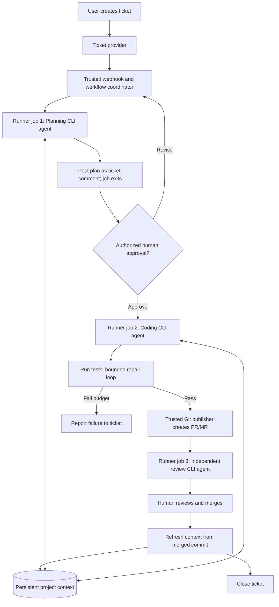
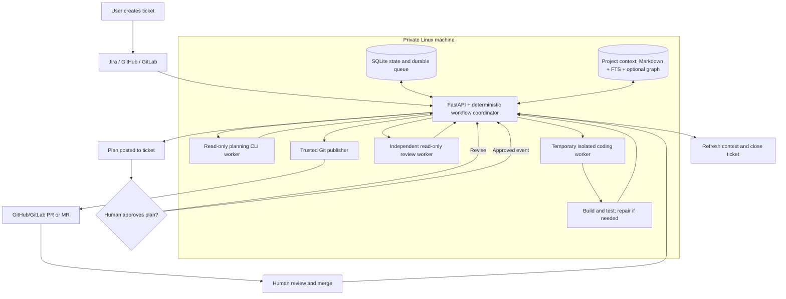
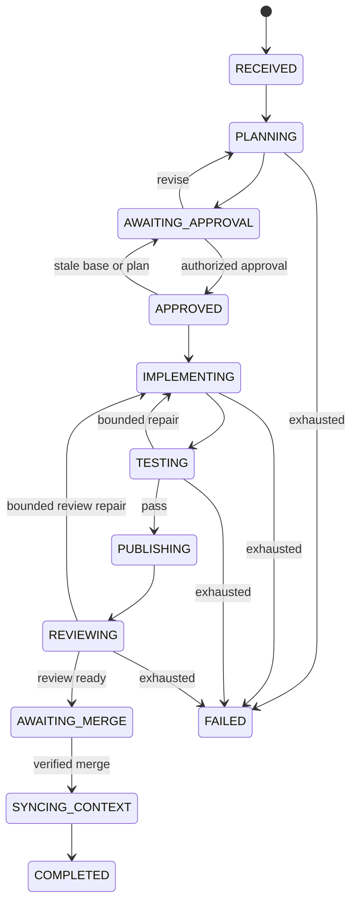
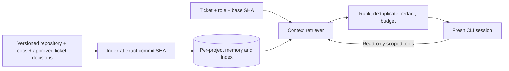

# Autonomous Coding Platform — Execution Plan

**Status:** Proposed, ready for architecture approval.  
**Revision:** 1.0 | 2026-11-24  
**Audience:** Codex / Claude Code acting as implementation engineers.

## 0. Instructions to the implementation agent

Treat this file as the source of truth for building the platform, not as an instruction to immediately execute arbitrary tickets. Start in a new, explicitly selected repository. Do not inspect unrelated local folders. Do not overwrite an existing project without permission. First validate the dependencies and produce a short architecture decision record (ADR), including any deviations from this plan. Obtain human approval before scaffolding. After approval, implement one milestone at a time, run its tests, and update the progress ledger below. Do not claim integrations work without evidence. Use fake adapters for repeatable tests; live tests require explicitly configured credentials and a disposable repository.

Keep this file updated with decisions, surprises, progress and validation results. Do not silently expand scope. Never commit credentials. Do not create remote repositories, push changes, or provision infrastructure without explicit authorization during development of this platform.

## 1. Objective and scope

Build a private, ticket-driven autonomous software engineering service for both existing repositories and new applications. A human creates a ticket, approves the agent's implementation plan in ticket comments, and approves the final PR/MR in GitHub/GitLab. Agents implement, test and review changes autonomously within bounded permissions. Maintain persistent project knowledge independently of any CLI session. Optimize total token usage without sacrificing accuracy.

**Non-goals for v1:** a custom LLM agent harness, OpenCode dependency, always-on multi-agent chat, LLM supervisor, Kubernetes, Redis, mandatory vector database, custom ticket UI, automatic production deployment, autonomous merge, or hosting inference models locally. No promise of supporting every build stack on limited hardware.

**Defaults proposed for approval:** Python 3.12+, FastAPI, Pydantic, SQLAlchemy/Alembic with SQLite WAL on a local disk, rootless Podman (Docker alternative), GitHub first, GitLab second, Jira third. Codex CLI and Claude Code CLI are interchangeable execution engines; implement Codex first but design both contracts before coding. Use CodeGraphContext as an optional code intelligence provider after validating its resource usage and incremental indexing behavior. The minimal context provider must work without it. Review using an independent CLI profile; PR-Agent is not required.

## 2. Architecture A — GitHub/GitLab runners



The coordinator is a small trusted control plane, not an AI agent. It stores the approved plan, base SHA, job state and artifact references. Runner jobs receive a short-lived, job-scoped grant; they do not share a mutable SQLite database over the network. Use authenticated coordinator endpoints for task claims, artifact upload and context retrieval. GitHub Actions dispatch or GitLab pipeline trigger is an execution transport, not the authority that approves a plan. For runner-only installations without a coordinator, a separate design for durable state and approvals would be required; it is not in v1.

Use trusted workflow definitions, dedicated runner groups, pinned actions/images and no privileged jobs. Do not run arbitrary fork code on secret-bearing self-hosted runners. Keep runner execution and publishing credentials separate. Runner may be hosted or self-hosted according to data residency policy. Waiting for approval consumes no runner slot. A failed review routes a bounded repair job before human review, or escalates to a human.

## 3. Architecture B — One private cloud machine (v1 priority)



The diagram shows logical connections, not simultaneous agents. The coordinator enforces the state machine below. Only one worker runs at a time initially. Planner, coder, tester and reviewer are fresh CLI sessions with different policy profiles, not four permanent services. A temporary isolated worker receives only the task workspace and authorized context. The trusted publisher performs Git writes outside the untrusted worker. After publishing, destroy the coding container; review can use a separate read-only snapshot. No agent remains running while a human decides.

## 4. Architecture decisions and boundaries

| Layer | Responsibility |
|---|---|
| Control plane | Auth, webhook normalization, approval, state transitions, scheduling, budgets, audit |
| Execution plane | CLI invocation and isolated build/test jobs; no ticket or Git write credentials |
| Context plane | Repository snapshots, retrieval, project memory, indexing and versioning |
| Integration plane | Ticket comments/status, Git read/publish, runner dispatch |
| Inference plane | Approved Codex/Claude authentication and model access; external by default |

One host does not mean one trust boundary. Use separate service users, storage directories and credentials. Do not expose the container runtime socket to a worker. Rootless containers reduce risk but are not VM-equivalent isolation. Stronger isolation (microVM or dedicated VM) is necessary for mutually untrusted tenants or hostile workloads; such workloads are outside the one-host v1 security claim.

## 5. Agent contracts and policies

| Profile | Inputs | Outputs | Permissions | Initial input target per invocation |
|---|---|---|---|---:|
| Planner | Ticket, base SHA, project rules, relevant code | Plan JSON | Read-only workspace; no arbitrary execution in v1 | 8–16k |
| Coder | Approved plan, relevant files, acceptance criteria | Patch and implementation report | Workspace write, constrained commands | 16–32k |
| Tester | Plan, changed files, bounded failure logs | Test changes if allowed, failure report | Test commands; changes limited to test scope by policy | 4–8k |
| Reviewer | Approved plan, exact diff, test results, selected context | Structured findings | Read-only, no Git writes | 8–16k |

Input targets are planning estimates, not guaranteed CLI context caps or benchmarks. Track all observed input/output/cached tokens across all turns; mark missing usage as unknown, not zero. Apply wall-clock timeout, max turns where supported, capped logs, bounded retry count, and provider spend limits where available. Do not assume CLI temperature is configurable; expose only supported model/reasoning settings. Fresh sessions isolate history; same model may be used for multiple roles. Independent review reduces shared conversation bias, not correlated model errors. Run actual tests deterministically; invoke the Tester agent only for test design or diagnosis, not routine execution.

Suggested defaults: max concurrent agent jobs 1; max repair iterations 2; max review repair iterations 1; per-stage wall time 15 minutes (configurable; builds may need more). Fail closed when a required permission or isolation feature is unavailable. A budget limit that cannot be enforced precisely must be documented and must not be advertised as a hard cap.

### 5.1 Common engine interface (proposed Python contract)

```python
class AgentEngine(Protocol):
    async def capabilities(self) -> EngineCapabilities: ...
    async def run(self, request: AgentRequest) -> AgentResult: ...
    async def cancel(self, run_id: str) -> None: ...
```

AgentRequest: run_id, project_id, role, workspace_ref, base_sha, approved_plan_ref (required for write roles), prompt, context_manifest, output_schema, permission_profile, model_config, timeout, budget.

AgentResult: status, exit_code, validated_output, artifact_refs, usage (nullable fields), duration, provider_session_id (optional), diagnostic_code. Never pass full conversation transcripts to subsequent agents. Validate result schemas and artifact sizes; treat CLI output as untrusted data.

Codex adapter: investigate `codex exec`, JSON event stream, output schema, sandbox modes and noninteractive approval settings for the pinned version. Claude adapter: investigate `claude -p`, structured output, permission modes, tool allow/deny rules, turn/budget flags and JSON output for the pinned version. Never use blanket sandbox/permission bypass to make automation work. Isolate CLI home/config, disable unapproved hooks/plugins/MCP servers and prevent repository settings from weakening controls. Use argv arrays, stdin or protected prompt files, not shell interpolation. Cancellation must terminate the process group/container. Use versioned fixture event streams and malformed-output tests. No interactive auth prompts in workers; choose provider-supported service authentication, not copied personal session credentials. Check commercial usage terms and approved model data policies.

### 5.2 Sample platform configuration (not native CLI configuration)

```yaml
agents:
  planner: {engine: codex, permission: read_only, input_target: 12000}
  coder: {engine: codex, permission: workspace_write, input_target: 24000}
  tester: {engine: codex, permission: test_scope, input_target: 8000}
  reviewer: {engine: claude_code, permission: read_only, input_target: 12000}
execution:
  backend: local_container
  max_concurrent_jobs: 1
  max_repair_iterations: 2
  max_review_repair_iterations: 1
context:
  provider: sqlite_fts
  graph_provider: disabled
```

Use Codex for reviewer when Claude is not configured. Never silently fall back to an unapproved provider. Configure role prompts in version-controlled trusted files, not in a mutable target repository.

## 6. Workflow state machine



Also support CANCELLED from nonterminal states, BLOCKED for permissions/quota/config, retryable failure with lease recovery, and context sync retry without duplicating publication. A cancel request stops new work immediately and terminates active execution; already published branches remain visible and are marked cancelled. Human review findings can request another bounded repair cycle; material scope changes require a new plan approval. No LLM may write workflow state directly. Enforce transitions transactionally with optimistic version checks; use durable outbox for side effects. State transitions and jobs must be idempotent across webhook redelivery and process restarts. Handle out-of-order events by fetching authoritative provider state.

### 6.1 Approval protocol

Ticket labels or explicit opt-in command enable planning (avoid acting on every ticket). Bot posts plan version, short plan digest, exact base SHA, affected files/modules, migrations, risks, test strategy, estimated resource needs and acceptance criteria. Commands: `/approve-plan v1 <digest>`, `/revise-plan <feedback>`, `/cancel`, `/status`. Authenticate webhook, re-fetch comment and actor authorization from provider, verify project/ticket association, allowlisted maintainers, version, digest, expiry and unchanged ticket revision. Ignore bot-generated comments. Record actor ID, provider event/comment IDs and timestamp. Use a server-side approval record and job gate before provisioning any coding workspace. Recheck approval and SHA before publishing; stale or materially changed plans must be re-approved. Approval grants only the approved work, not arbitrary commands or infrastructure access.

Final merge must be enforced by protected branches, required CI and required human review at the Git provider. Agent identity cannot approve or merge its own PR. If provider plan/tier cannot enforce branch protections, block production use until an equivalent control is configured. Review comments are advisory; a human handles exceptions and accepted risks.

## 7. Persistent project context



Three kinds of memory: (1) repository facts indexed at a commit; (2) human-validated architecture, rules and decisions; (3) task artifacts and temporary execution state. Never treat model summaries as canonical truth. Store provenance (source path/ticket, commit, timestamps, trust level, content hash). Separate target repository knowledge from platform configuration and CLI session data. Project registration maps a provider repository ID to its ticket project and authorized users; do not accept arbitrary repository URLs from tickets.

Existing project onboarding: fetch trusted default branch, inventory tracked files/languages/build/test manifests, read vetted project documentation, exclude secrets/generated/vendor/binary files, create repo map and SQLite FTS5 index, propose architecture summary for human validation. Optional CodeGraphContext indexes supported languages and provides symbol/dependency queries via MCP. Store separate index per project and commit; use incremental changes where verified, otherwise rebuild. Unsupported languages fall back to text search. Never assume one graph backend or incremental feature is available in every version.

New project: onboard an explicitly registered empty repository; planner proposes stack, architecture, scaffolding, security and acceptance criteria; approved coder creates files and baseline tests. A remote repository must be provisioned by a human or a separately authorized provisioning flow. Index the merged scaffold just like any existing project.

Retrieval: filter by project and base SHA first, then rank exact path/symbol matches, FTS/BM25, dependencies if available, and validated relevant decisions. Always include project rules, acceptance criteria, concise repo map, file references and selected excerpts. Deduplicate and truncate by token estimate; allow scoped on-demand file reads. Never inject entire repo by default. Untrusted docs/tickets are data, not authority; project instructions cannot override security policy. Do not index secrets or raw logs. Restrict graph/MCP tools to one project and read-only queries, limit output size and disable tool endpoints that mutate host state.

Refresh on verified merge/default-branch push, based on exact merged SHA, including renames/deletions and changed docs. Update snapshot atomically; if indexing fails, preserve last good snapshot and flag stale. For an approved base with no matching index, perform on-demand scoped indexing or fall back to a fresh repository scan, never silently use stale facts. Context from unmerged code stays task-scoped and does not enter canonical memory. Keep task summaries only after validation, redact and enforce retention. Measure retrieval relevance, total tokens per successful ticket, first-pass test success and cost against a baseline without context optimization.

## 8. Data model and artifacts

Use UUID internal keys, UTC timestamps, foreign keys, tenant/project scope on every query and unique provider identifiers. Suggested tables:

| Table | Essential fields |
|---|---|
| projects | id, tenant_id, provider, repo_external_id, default_branch, ticket_mapping, policy_ref |
| tickets | id, project_id, external_id, revision_hash, status |
| runs | id, ticket_id, state, version, base_sha, plan_id, attempt_counts, cancel_requested |
| plans | id, run_id, version, digest, base_sha, ticket_revision_hash, artifact_id |
| approvals | id, plan_id, actor_id, provider_comment_id, decision, expires_at |
| jobs | id, run_id, stage, status, lease_owner, lease_until, attempts, idempotency_key |
| artifacts | id, project_id, run_id, kind, sha256, size, storage_ref |
| context_snapshots | project_id, commit_sha, index_version, status, storage_ref |
| usage | job_id, engine, model, input/output/cached_tokens nullable, duration, cost nullable |
| events | provider, delivery_id, payload_hash, processing_status |
| outbox | id, operation, idempotency_key, attempts, next_attempt_at |
| audit | project_id, run_id, actor, event_type, timestamp, redacted_metadata |

SQLite WAL, busy timeout, foreign keys, migrations, short transactions and single-host local filesystem. Claim jobs atomically with a lease and heartbeat; reclaim abandoned jobs after expiry, not while healthy. Reconcile external side effects before retry (search stable PR branch/run marker, comment marker, existing commit SHA). Back up database and artifact manifest consistently and test restore. Files stored under generated project/run IDs, never arbitrary user paths. Validate hashes, size, archive traversal and symlinks before importing. Keep audit events separate from verbose logs.

Plan JSON: schema_version, ticket_id, base_sha, objective, assumptions, affected_paths, steps, acceptance_criteria, test_commands (proposals), risks, migrations, scope_exclusions. Canonicalize and hash before approval. Implementation report: base_sha, patch_ref, changed_paths, completed_steps, deviations, test_evidence_refs. Test report: command_id, exit_code, duration, redacted_log_ref, result. Review report: diff_sha, verdict, findings[{severity,path,line,message,evidence}], limitations. Context manifest: project_id, indexed_sha, source_refs, estimated_tokens, redactions. Store each schema in `schemas/` and version it. Actual Git diff and test exit codes are verified by trusted components, not agent claims.

## 9. Integration interfaces and API

```python
class TicketProvider(Protocol):
    async def verify_event(self, headers, raw_body): ...
    async def fetch_ticket(self, external_id): ...
    async def check_approver(self, ticket, actor_id): ...
    async def post_comment(self, ticket, body, idempotency_key): ...
    async def set_status(self, ticket, status): ...

class ExecutionBackend(Protocol):
    async def submit(self, job_spec): ...
    async def status(self, execution_id): ...
    async def cancel(self, execution_id): ...

class ContextProvider(Protocol):
    async def index(self, project, commit_sha): ...
    async def retrieve(self, query, project_id, commit_sha, budget): ...

class GitProvider(Protocol):
    async def resolve_base(self, project): ...
    async def publish_patch(self, run, validated_patch): ...
    async def ensure_pull_request(self, run, branch): ...
    async def verify_merge(self, run, event): ...
```

These are design contracts; use typed DTOs rather than untyped dicts in implementation. LocalContainerBackend starts isolated jobs; GitHubRunnerBackend and GitLabRunnerBackend dispatch trusted jobs and accept authenticated callbacks. GitHub App installation credentials preferred for repository operations; GitLab scoped project credentials or supported equivalent; Jira auth configured per organization. Do not reuse Git write tokens in agent workers. Implement provider-specific webhook verification (GitHub HMAC; GitLab/Jira supported configured mechanism), constant-time checks where appropriate, HTTPS, replay/dedup and authorization. Provider event identity is not alone proof of approval.

Proposed REST: `POST /webhooks/{provider}`, `POST /v1/projects`, `GET /v1/projects/{id}/context/status`, `GET /v1/runs/{id}`, `POST /v1/runs/{id}/cancel`, `POST /internal/jobs/{id}/claim`, `/heartbeat`, `/result`, `GET /healthz`, `GET /readyz`. Admin and internal endpoints authenticated and scoped; ticket approval lives in provider comments, not an unauthenticated REST endpoint. Return webhook success only after durable event insert. Do slow work asynchronously in the local worker. Expose no raw shell command API. No custom UI required for v1.

## 10. Isolation and Git publishing

- Rootless worker; non-root user, no privileged mode, no host runtime socket, no host home mounts, restricted capabilities, no production secrets, resource cgroups, separate project/run workspace and ephemeral CLI home. Read-only filesystem except designated workspace/tmp. No shared writable dependency caches between untrusted projects. Restrict network to approved inference/registry endpoints; disable network for tests when possible. Deny cloud metadata access. Fail deployment if policy cannot be enforced.
- Clone/fetch through trusted service at verified commit using read credentials; strip credentials and unsafe Git config/hooks from worker. Agent cannot directly push. Use an approved credential broker/proxy where practical; document residual risk when CLI credentials must be available in its environment. Do not expose provider secrets to shell subprocesses unnecessarily. External inference may transmit private source; require organizational approval, region/retention policy and provider terms before enabling.
- Treat repo code, dependencies, tests, issue comments, MCP results and model output as untrusted. Disable unapproved repository hooks/config/tool servers. Never execute ticket text as shell. Pin trusted images/tools, use allowlisted build profiles, restrict egress and scan changes for secrets. Build scripts themselves are untrusted even when command names are allowed.
- Trusted publisher checks patch against exact base SHA; reject path escape, symlink tricks, unexpected binary/submodule changes and sensitive changes (CI/workflow, deployment, security policy) without explicit approved scope. Apply in a fresh trusted checkout with hooks disabled. Create branch `agent/<ticket-id>/<run-id>`, commit with ticket reference and plan digest, push only that branch, create/update PR/MR idempotently. Never execute repository code in publishing environment. Validate current head and base before every update. No force push or direct protected-branch write.
- Test and review evidence bound to exact patch/head SHA. Invalidate evidence when code changes. Report failed checks without hiding them. PR description contains ticket link, approved plan, summary, tests, review limitations. Human reviews in Git provider; verified merge event triggers context sync and ticket closure. Never close ticket merely because PR was created.

## 11. Proposed repository layout

```text
agent-platform/
  PLAN.md
  AGENTS.md
  README.md
  pyproject.toml
  .env.example
  configs/agents.example.yaml
  prompts/{planner,coder,tester,reviewer}.md
  schemas/
  src/agent_platform/
    api/               # webhook and admin endpoints
    domain/            # typed models, state machine, policies
    orchestration/     # coordinator, approval, outbox, budgets
    persistence/       # SQLite, repositories, migrations
    engines/           # base, codex, claude, fake
    execution/         # local container, GitHub/GitLab runner
    context/           # FTS, repo map, graph adapter, memory
    integrations/      # GitHub, GitLab, Jira
    git/               # trusted fetch and publication
    security/          # credential and sandbox policy
    worker/            # lease, heartbeat, job execution
    observability/     # audit and metrics
  migrations/
  infra/              # container images, deployment config
  workflows/          # trusted runner templates
  tests/{unit,integration,e2e,fixtures}/
  docs/{architecture,security,operations,adr}/
```

Do not create every directory as an empty abstraction. Create modules only when their milestone requires them. Prefer dependency injection and fake implementations over unnecessary framework layers.

## 12. Implementation milestones and acceptance gates

- [ ] M0 — Verify dependencies and approve design. Record pinned CLI versions, auth options, output schemas, sandbox behavior, licenses and provider limitations. Document threat model, approved egress and resource assumptions. Obtain human approval. Exit: ADR and reproducible smoke-test instructions; no live credentials required.
- [ ] M1 — Domain and durable workflow. Scaffold FastAPI, typed states, SQLite migration, queue lease, outbox, fake adapters, approval commands. Exit: duplicate webhook schedules one run; unauthorized/stale approval rejected; no write job before approval; crash/restart resumes safely; cancellation works.
- [ ] M2 — CLI engine adapters and sandbox. Implement Codex first, Claude second; capability checks, structured output validation, cancellation, usage parsing, policy and timeout. Exit: fake CLI fixtures pass; authorized live smoke test reads a sample repo, generates plan and edits only a disposable workspace; read-only roles cannot edit; unsupported settings rejected; no host access.
- [ ] M3 — Project context. Register existing/empty repos, repo map, FTS5, versioned memory, scoped retrieval and budget manifest; optional graph/MCP spike. Exit: two-project isolation, relevant symbol retrieval, merge update/deletion test, stale index detection and token baseline measurement. Do not require graph for MVP.
- [ ] M4 — GitHub integration and end-to-end local execution. Verified issue/comment events, plan posting/approval, coding/test loop, trusted patch publication, PR creation and independent review. Exit: a sample feature ticket yields exactly one PR after approval, failed tests block publication, repeated events do not duplicate PR, human merge updates context and closes ticket. Test a new app and an existing repo.
- [ ] M5 — GitLab then Jira. Implement GitLab note/issue/MR hooks and Git publisher; implement Jira ticket adapter with explicit mapping to Git provider. Exit: same workflow contract tests for each supported combination; unauthorized actors rejected; verified merge closes mapped ticket. Document unsupported provider editions/features.
- [ ] M6 — Runner backend. Implement trusted GitHub Actions dispatch and GitLab pipeline trigger, authenticated claims/results, remote artifact handling, runner cancellation. Exit: same plan and workflow run through local and runner backends; idle approval uses no runner; callback replay rejected; duplicate dispatch safely reconciled. No remote SQLite mount.
- [ ] M7 — Hardening and deployment. Resource limits, redaction, backup/restore, telemetry, operator runbook and dependency updates. Exit: threat-model negative tests, failure recovery, resource benchmark on target host, credential rotation and rollback exercise. Production launch requires explicit security review.

### Mandatory cross-cutting tests

Test webhook forgery/replay, actor permission revocation, plan tampering, changed ticket/base SHA, duplicate event, expired lease, crash after push before DB commit, malformed JSON, timeout/cancel, provider rate limit, context leakage across projects, path traversal, secret redaction, malicious repository instructions, forbidden workflow edits, changed diff invalidating review, merge event for wrong PR, stale context and failed index update. Test actual container resource enforcement and network controls, not just mocks. Never use production repositories for destructive tests.

## 13. Resource and operational targets

Start with 2–4 vCPU, 8–12 GB RAM, 40–100 GB SSD, Linux, external inference; 4 GB RAM is an experimental minimum only for small builds. Initial concurrency 1. Proposed worker cap 2 CPU / 4 GB RAM on an 8 GB host, adjustable per project; reserve RAM for OS/coordinator/index. Configure disk quotas, log retention, bounded artifacts, cleanup of expired workspaces and backups. Index on demand, avoid running full indexing concurrently with memory-heavy builds. Reuse only vetted read-only caches or project-scoped caches. No GPU required for external inference. ARM64 and x86 support depend on CLI images and build dependencies; verify target architecture before deployment.

Metrics: job queue latency, completion rate, human approval latency, per-role tokens/cost (unknown if unavailable), repair count, test pass rate, index freshness, peak CPU/RAM/disk, security denials, cancellation and recovery. Use structured redacted logs and minimal metrics endpoint initially. Evaluate against a fixed set of representative bug/feature/new-app tickets; record total tokens and accepted PR rate, not just initial prompt size. No claimed savings until measured.

## 14. Definition of done (v1)

A documented demo on one private host proves an existing project and an empty registered repo can progress from ticket to human-approved plan to isolated implementation to tested PR/MR to independent review to human merge to refreshed context. Both CLI adapters have contract tests and at least one authorized live smoke test each. The runner backend passes the same workflow tests. No coding before approval, no autonomous merge, no cross-project context leak, no privileged worker, and no false claim of test or review success. Deployment instructions, backup/restore, limitations and resource measurements are present.

## 15. Reference documentation and verification notes

Research entry points (verify current versions and exact flags in M0; not all integrations have been live tested):

- Codex repository: https://github.com/openai/codex
- Codex noninteractive integration options: https://developers.openai.com/blog/codex-as-a-platform
- Codex structured review/repair example: https://developers.openai.com/cookbook/examples/codex/build_iterative_repair_loops_with_codex
- Claude Code repository: https://github.com/anthropics/claude-code
- Claude Code settings/permissions: https://code.claude.com/docs/en/settings
- Claude Code CLI documentation: https://code.claude.com/docs/en/cli-reference
- CodeGraphContext: https://github.com/CodeGraphContext/CodeGraphContext
- CodeGraphContext architecture: https://github.com/CodeGraphContext/CodeGraphContext/blob/main/docs/ARCHITECTURE.md
- GitHub Actions security: https://docs.github.com/en/actions/reference/security/secure-use
- GitLab webhooks: https://docs.gitlab.com/user/project/integrations/webhook_events/
- GitLab CI/CD: https://docs.gitlab.com/ci/

Codex CLI is an open-source harness; Claude Code CLI and its inference/service terms must be evaluated separately. Do not assume either subscription grants unattended multi-user commercial automation or unrestricted API usage. Check licenses of all pinned dependencies before distribution. This plan intentionally does not fix a specific model, ticket provider subscription, cloud vendor, or credentials without user approval.

## 16. Progress and decision ledger

- 2026-11-24: Initial proposed architecture; local-container backend first, runner backend later; Codex and Claude Code CLI adapters; deterministic orchestration; FTS-first context with optional graph; human approval required. No implementation or live integration test performed yet.
- Next action: M0 verification and ADR, followed by human approval. Record milestone date, commands/tests, outcomes, deviations and unresolved risks here.

### Runner-first pilot

- 2026-11-24: The user selected GitHub/GitLab runners first and deferred the cloud server. Start with the runner transport portion of M6 and M0 dependency checks. See [the decision record](docs/runner-first.md) for the revised sequence and verification boundaries.
